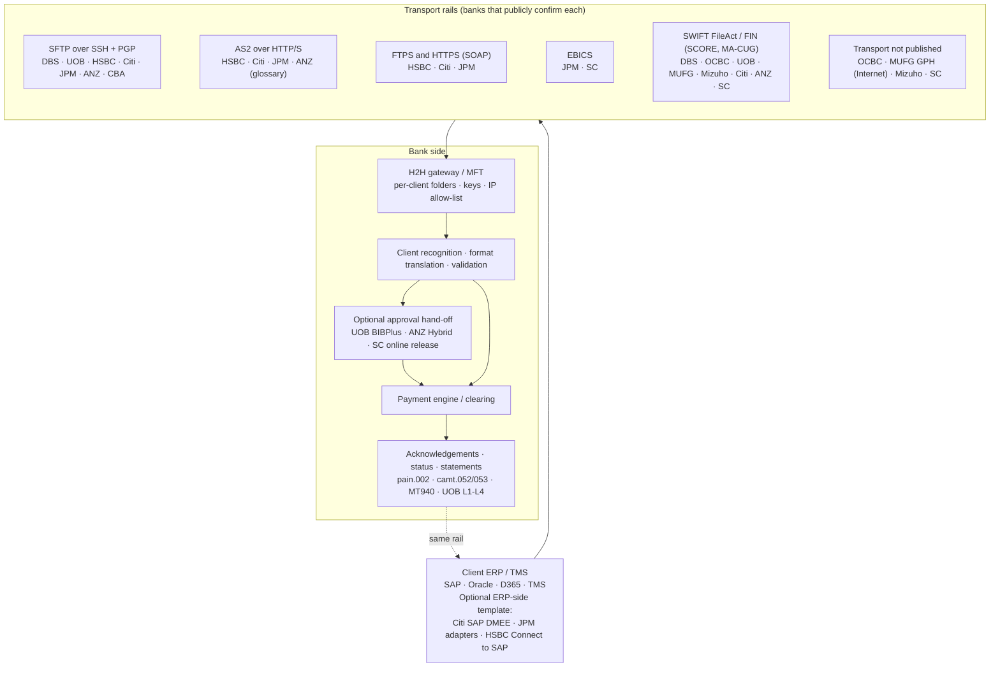
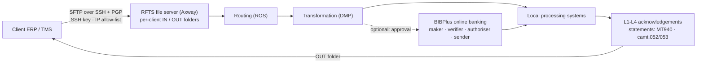
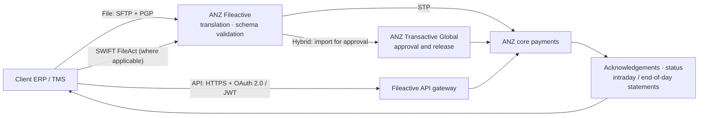

# APAC Bank Host-to-Host (H2H) Connectivity: Protocols, Architecture and URLs

**Prepared:** 10 October 2026 · **Method:** public-source research · **Scope:** H2H file connectivity at DBS, OCBC, UOB, HSBC, Standard Chartered, Citi, J.P. Morgan, MUFG, Mizuho, ANZ and CBA, with Goldman Sachs and ING as non-APAC protocol references

Evidence grade (Ev.): **A** bank-published technical detail · **B** bank marketing page · **C** third-party or dated source. "Not published" means the pages I found do not say; it does not mean unsupported. Abbreviations: SC = Standard Chartered, JPM = J.P. Morgan, CBA = Commonwealth Bank.

---

## 1. H2H comparison table

| Bank | H2H product (markets) | Protocols and security | Formats | Alternative file rails | Architecture flow (text) | Onboarding, limits, acknowledgements | URLs | Ev. |
|---|---|---|---|---|---|---|---|---|
| **DBS** | IDEAL Connect (SG, IN, ID, CN, TW and others) | SFTP; PGP-encrypted files; fixed source IPs and cipher requirements (customer story, third party). Client chooses its own integration software. | Not published on bank pages. Payment types (SG): domestic transfers, GIRO, MEPS, cheque, TT, demand draft. Reports: statements in CSV, Excel, SWIFT format (India page). | IDEAL Connect for SWIFT (FIN, FileAct); RAPID API (HTTPS REST/JSON + PGP) | Client ERP (SFTP + PGP, fixed IP) -> DBS IDEAL Connect gateway -> STP with customised pre-processing and routing -> DBS payment/CMS systems -> status/report files + email alerts -> Client ERP | 4-6 weeks including testing (SG, IN, ID); about 2 months (CN). Real-time email alerts on file status. | https://www.dbs.com.sg/sme/day-to-day/ways-to-bank/ideal-connect https://www.dbs.com/in/sme/day-to-day/ways-to-bank/ideal-connect https://www.dbs.com.cn/corporate/solutions/digital/ideal-connect https://www.files.com/customer-stories/busy-bees-singapore-busy-bees-needed-to-connect-its-netsuite-erp-directly-to-dbs | A/C |
| **OCBC** | Host-to-Host (H2H) (SG; HK/Macau teams) | Not published. Described as secure digital file transfer without human intervention. | Not published. TT and MEPS payments via H2H must follow ISO 20022 CBPR+ updates ahead of the November 2026 deadline. | SWIFT FileAct and FIN; Velocity File Upload (portal); API | Client ERP (file; protocol not published) -> OCBC H2H gateway (inferred) -> OCBC payment systems -> status/reports (inferred) | Not published. | https://www.ocbc.com/business-banking/corporates/transaction-banking https://www.ocbc.com/business-banking/digital-business-banking/iso20022 | B |
| **UOB** | Regional File Transfer Services, RFTS (SG, MY, TH, ID, VN, CN, HK) | SFTP over SSH; PGP; SSH key + IP allow-list; UAT server (deck). | ISO 20022 XML (pain.001.001.03 / pain.002.001.03 per deck), UOB delimited and fixed-length. Reports: MT940/942, camt.052/053. | SWIFT FileAct (ISO 20022 CCT v3 or UOB formats) and FIN MT101; API Services | Client ERP (SFTP, SSH key + PGP, IP allow-listed) -> UOB RFTS file server (Axway; per-client IN/OUT folders) -> routing (ROS) -> transformation (DMP) -> local processing systems -> L1-L4 ack/status files to OUT folder -> Client ERP. Optional: -> BIBPlus approval before processing | Four acknowledgement levels: L1 received, L2 rejected, L3 accepted, L4 processing status; SLAs in the deck. UAT credentials and firewall steps before go-live. | https://www.uob.com.sg/business/digital/regional-file-transfer-services.page https://www.uobgroup.com/techecosystem/sff/pdf/regional-file-transfer-services-capabilities.pdf https://www.uob.com.sg/business/digital/swift-services.page | A |
| **HSBC** | HSBC Connect (50+ countries; some pages say 40+) | FTPS, SFTP, HTTPS (SOAP), AS2; PGP. | ISO 20022 XML, EDIFACT, SWIFT, local in-country. All transaction data can be sent in one file format; HSBC validates, sorts and routes it. | HSBC APIs (payment initiation in 13 APAC markets); HSBC Connect to SAP (dated) | Client ERP/TMS (SFTP/FTPS/AS2/HTTPS + PGP) -> HSBC Connect gateway -> validate, sort, route -> HSBC payment and reporting systems -> confirmations and statements -> Client ERP | Not published. Positioned for automated reconciliation and high STP. | https://www.business.hsbc.com.ph/en-gb/products/hsbc-connect https://www.business.hsbc.com.vn/en-gb/solutions/hsbc-connect https://business.hsbc.com.au/en-au/ways-to-bank/hsbc-connect | A |
| **Standard Chartered** | Straight2Bank Access with Universal Adaptor | H2H transport protocols not published on public pages; EBICS and SWIFT named. Resources hosted on SC Open Banking Marketplace. | ISO 20022 (H2H and API address guidelines, Sept 2025). Client-defined templates or pre-built library via Universal Adaptor, with character conversion. | SWIFT, EBICS; Straight2Bank API | Client ERP/TMS (H2H / SWIFT / EBICS; native file) -> Universal Adaptor (template mapping) -> S2B Access gateway -> SC payment systems -> status/reports back. Optional: -> S2B Web approval | Universal Adaptor cited for rolling out new entities in hours (2013 customer quote). No formal timeline published. | https://www.sc.com/en/corporate-investment-banking/transaction-banking/straight2bank/ https://www.sc.com/en/support-centre/quick-links/ https://www.sc.com/en/uploads/sites/66/content/docs/sc-cib-tb-ISO-20022%E2%80%93CBPR-Address-guidelines-H2H-and-API-sept-2025.pdf https://ctmfile.com/story/standard-chartered-launches-universal-adaptor-file-converter | A/B |
| **Citi** | CitiConnect for Files (90+ countries) | SFTP (password or certificate), FTPS (implicit and explicit SSL), AS2 (HTTP or HTTPS), HTTPS (EMEA page). | ISO 20022 XML (most used), CBI XML, EDIFACT, CP2E (Citi proprietary), SAP IDoc, CDFF. | CitiConnect for SWIFT; ERP Integrator (SAP DMEE); CitiConnect API | Client ERP/TMS (SFTP/FTPS/AS2/HTTPS) -> CitiConnect file gateway -> Citi payment platform -> response files -> Client. SAP clients: F110 payment run -> DMEE template -> F111 medium -> CitiConnect | Real-time response files confirm file and transaction status or give reject reasons; online tracking. | https://citi.com/icg/sa/emea/hungary/english/sections/internet-banking/citiconnect.html https://www.citibank.com/icg/sa/emea/pakistan/tts/electronic-banking-products/cdbe.html https://ctmfile.com/story/citiconnect-erp-integrator-enables-corporate-clients-in-over-90-citi-branch | A/B |
| **J.P. Morgan** | Access Host-to-Host | SFTP, HTTPS, EBICS, AS2 (H2H page). Connectivity guide (third-party copy): SSL, AS2, FTPS, SFTP transport; PGP and X.509 payload encryption; partner key management; firewall rules. | ISO 20022, X12, Global Flat File. | ERP Adapters (Oracle EBS, D365, SAP); Payments APIs | Client ERP/TMS (SFTP/HTTPS/AS2/EBICS) -> JPM H2H file service -> JPM payments -> status and reports -> Client. ERP adapter: payment run -> adapter template (pain.001) -> H2H | Not published; the guide covers key management and error troubleshooting. | https://www.jpmorgan.com/payments/client-resource-center/h2h https://www.scribd.com/document/686611748/H2H-Connectivity-Guide-V7-3 https://partners.jpmorgan.com/oracle_ebs.html | A/C |
| **MUFG** | Global Payment Hub (GPH), COMSUITE; MUFG Unity (ASEAN) | Internet or SWIFT connectivity; transport protocols not published. | pain.001.001.03, MT101 and others, published as Swift MyStandards specifications by region and country (structured or unstructured). | SWIFT: MA-CUG or SCORE; FIN MT101/MT940/MT942; FileAct pain.001 and pain.002 (ISO 20022 XML) | Client ERP/TMS (Internet or SWIFT) -> MUFG GPH -> MUFG host/clearing -> status/reports. Unity: -> MUFG H2H -> MUFG or partner-bank local rails (Krungsri, VietinBank, Security Bank, Danamon) -> consolidated report | Not published. | https://www.bk.mufg.jp/global/productsandservices/transaction/cashmanagement/index.html https://www.bk.mufg.jp/global/productsandservices/transaction/cashmanagement/swiftconnectivity.html https://www.bk.mufg.jp/global/globalnetwork/asiaoceania/tbsupport/GPH_Swift_MyStandards_UserGuide_20231106.pdf https://www.bk.mufg.jp/global/globalnetwork/asiapacific/anncts/pdf/apacnews-20260427-01-en.pdf | A/B |
| **Mizuho** | Global Host-to-Host Service | Not published; contact the relationship manager. | Not published for H2H. SWIFT service: FIN MT101, MT199, MT940, MT942 and ISO 20022 pain.001, pain.002, camt.052, camt.053. Global e-Banking portal: CSV (SWIFT-compatible). | SWIFT Connectivity Services for Corporates; SAP MBC member channel (June 2026) | Client ERP/TMS -> Mizuho H2H -> Mizuho host (flowchart on the page is an image, not readable). Via MBC: Client SAP -> SAP MBC -> Mizuho | Payment factory for large volumes; consolidated report that can include other banks' accounts where those banks send data. | https://www.mizuhogroup.com/bank/what-we-do/cash-management?tab=mizuho-global-host-to-host-service https://library.mizuhogroup.com/asset/400d2e7a-f201-4c0e-a625-c3b385aa7bc1/bk_20260602release_eng.pdf | B |
| **ANZ** | Fileactive Host-to-Host (HK, IN, ID, PH, SG, TW, VN) | SFTP with dedicated non-prod folders and endpoints; PGP key management; SWIFT FileAct where applicable. AS2 and FTP appear in the glossary (not confirmed as offered). | ISO 20022 XML recommended (pain.00x, camt.052, camt.053). ABA, BAI2, CSV, SAP Multicash and bespoke formats via bi-directional translation. | Fileactive APIs (HTTPS, OAuth 2.0 + JWT, mTLS in sandbox); SWIFT FileAct/SCORE+ | Client ERP (file; PGP; SFTP) -> ANZ Fileactive (translation and validation) -> [Hybrid: Transactive Global approval] -> ANZ core payments -> ack, status and statement files -> Client ERP | 4-8 weeks; non-prod environments; acknowledgements confirm receipt. Limits: 80,000 items per batch, 4 MB per file, 500 batches per file. Funds check on submission (HK, IN, PH, SG, VN). | https://help.online.anz.com/hc/en-au/articles/4412678689305-ANZ-Fileactive-FAQs https://help.online.anz.com/hc/en-au/articles/4412678695065-ANZ-Fileactive-Overview https://help.online.anz.com/hc/en-au/articles/43605390311705-ANZ-Fileactive-Connection-Types https://help.online.anz.com/hc/en-au/articles/40288605668633-ANZ-Fileactive-Changes | A |
| **CBA** | CommBiz Automated, Secure File Transfer (Australia) | SFTP via DNS endpoint securetransfer.commbank.com.au; an upgrade programme tracks clients' SFTP software versions and ciphers; ISO-8859-1 character set. | ABA payment files (testing guidance). ISO 20022 pain.001.001.03 and pain.008.001.02 supported in CommBiz file import. | Banking and payments APIs (PayTo, NameCheck) | Client ERP (SFTP; files in CommBiz outbox/inbox) -> securetransfer.commbank.com.au -> CommBiz validation (Production mode) -> CBA payments -> report files back | Pilot Mode (files not validated) then Production Mode (collected, validated, processed). A CommBank project manager supports testing. | https://www.commbank.com.au/institutional/client-solutions/corporate-and-institutional-transaction-banking/connectivity-data-solutions.html https://www.commbank.com.au/business/online-banking/commbiz/user-guides/commbiz-automated-sftp-upgrade.html | A |
| **Goldman Sachs** (reference, non-APAC) | Transaction Banking file connectivity | SFTP push (payments) and pull (responses, statements); SSH public key (RSA 1024-4096); IP/CIDR allow-list; PGP encryption and signing, public keys exchanged both ways (RSA or DSA/ElGamal 1024-4096). | ISO 20022 via EBICS (pain.001, camt.052/053, pain.002); others per file support dictionary. | SWIFT FileAct (store-and-forward and real-time; generic and corporate); EBICS v2.5 | Client (SFTP push, PGP sign + encrypt) -> GS SFTP -> Transaction Banking; Client pulls responses from GS SFTP | Prerequisites: SSH key, IP list, PGP keys. | https://developer.gs.com/docs/services/transaction-banking/fileconnectivity/ https://developer.gs.com/docs/services/transaction-banking/ebicsconnectivity/ | A |
| **ING** (reference, non-APAC) | InsideBusiness Connect File Transfer | sFTP, AS2, FTPS; authentication via TLS certificates or SSH-RSA keys; confidentiality and non-repudiation via CMS or PGP. | ISO 20022 XML and other industry formats. | n/r | Client ERP/TMS (sFTP/AS2/FTPS) -> ING file transfer -> ING network including third-party accounts | Test connectivity and formats in the ING customer onboarding environment. | https://www.ingwb.com/en/digital-banking-services/insidebusiness-connect-file-transfer | A |

---

## 2. Protocol-to-bank index (supports the diagram)

| Protocol / rail | Banks that publicly confirm it | Evidence URLs |
|---|---|---|
| **SFTP over SSH** | DBS (customer story), UOB, HSBC, Citi, JPM, ANZ, CBA | DBS: https://www.files.com/customer-stories/busy-bees-singapore-busy-bees-needed-to-connect-its-netsuite-erp-directly-to-dbs UOB: https://www.uob.com.sg/business/digital/regional-file-transfer-services.page HSBC: https://www.business.hsbc.com.ph/en-gb/products/hsbc-connect Citi: https://citi.com/icg/sa/emea/hungary/english/sections/internet-banking/citiconnect.html JPM: https://www.jpmorgan.com/payments/client-resource-center/h2h ANZ: https://help.online.anz.com/hc/en-au/articles/4412678689305-ANZ-Fileactive-FAQs CBA: https://www.commbank.com.au/business/online-banking/commbiz/user-guides/commbiz-automated-sftp-upgrade.html |
| **PGP (file or payload encryption and signing)** | DBS (customer story), UOB, HSBC, JPM (guide, third-party copy), ANZ | Same URLs as SFTP for DBS, UOB, HSBC, ANZ; JPM: https://www.scribd.com/document/686611748/H2H-Connectivity-Guide-V7-3 |
| **AS2 (HTTP/S + S/MIME)** | HSBC, Citi, JPM; ANZ (glossary only) | HSBC and Citi pages above; JPM H2H page above; ANZ FAQ above |
| **FTPS and HTTPS (SOAP / web service)** | HSBC (FTPS, HTTPS SOAP), Citi (FTPS, HTTPS), JPM (HTTPS; FTPS per guide) | HSBC, Citi and JPM pages above |
| **EBICS** | JPM, SC | JPM H2H page above; SC: https://www.sc.com/en/corporate-investment-banking/transaction-banking/straight2bank/ |
| **SWIFT FileAct / FIN (SCORE, MA-CUG)** | DBS, OCBC, UOB, MUFG, Mizuho, Citi, ANZ, SC | DBS: https://www.dbs.com.sg/sme/day-to-day/ways-to-bank/connect-for-swift OCBC: https://www.ocbc.com/business-banking/digital-business-banking/iso20022 UOB: https://www.uob.com.sg/business/digital/swift-services.page MUFG: https://www.bk.mufg.jp/global/productsandservices/transaction/cashmanagement/swiftconnectivity.html Mizuho: https://www.mizuhogroup.com/bank/what-we-do/cash-management?tab=mizuho-global-host-to-host-service Citi: https://citi.com/icg/sa/emea/hungary/english/sections/internet-banking/citiconnect.html ANZ: https://help.online.anz.com/hc/en-au/articles/52634910247321-December-Announcements-2025 SC: https://www.sc.com/en/corporate-investment-banking/transaction-banking/straight2bank/ |
| **Transport not published** | OCBC, MUFG GPH (Internet), Mizuho, SC (H2H) | Product pages in the table above |

**Common H2H pattern across banks (my view):** SSH key plus IP allow-list for transport, PGP sign-and-encrypt for the payload, per-client IN/OUT folders, a non-production environment before go-live, bank-side format translation and validation, and acknowledgement or status files returned on the same rail. Goldman Sachs and ING publish this pattern most explicitly.

---

## 3. Architecture diagrams

The diagrams use Mermaid. Paste them into https://mermaid.live or any Mermaid-enabled viewer if they do not render here.

### 3.1 Protocol map: client to bank H2H (all banks)

URLs behind this diagram: section 2 (protocol-to-bank index).

### 3.2 UOB RFTS (most detailed public flow)

URLs: https://www.uobgroup.com/techecosystem/sff/pdf/regional-file-transfer-services-capabilities.pdf · https://www.uob.com.sg/business/digital/regional-file-transfer-services.page

### 3.3 ANZ Fileactive (STP and hybrid)

URLs: https://help.online.anz.com/hc/en-au/articles/4412678689305-ANZ-Fileactive-FAQs · https://help.online.anz.com/hc/en-au/articles/4412678695065-ANZ-Fileactive-Overview · https://help.online.anz.com/hc/en-au/articles/43605390311705-ANZ-Fileactive-Connection-Types

---

## 4. Limitations

- Public sources only; bank pages can be region-specific. Citi protocol detail comes from an EMEA page.
- DBS protocol detail comes from a third-party customer story. OCBC, SC, MUFG and Mizuho publish no H2H transport detail on the pages found.
- ANZ lists AS2 and FTP only in a glossary.
- The J.P. Morgan connectivity guide is a third-party copy of a bank document.
- J.P. Morgan and CBA SWIFT connectivity were not researched; HSBC SWIFT connectivity is shown only in dated sources and is not in the protocol map.
- Component names in the UOB flow (ROS, DMP) are as published in the deck and are not interpreted further.
